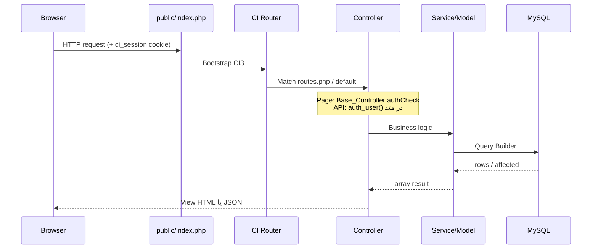
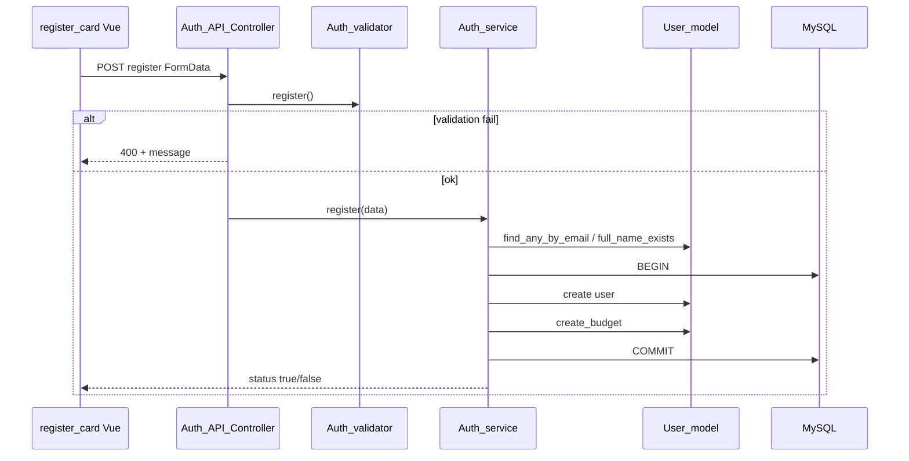
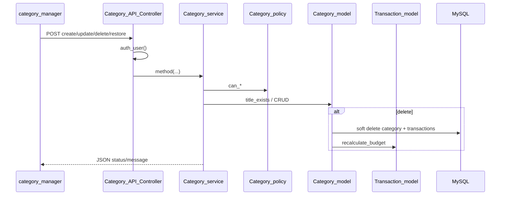

# ۳. جریان‌های اجرای ویژگی‌های اصلی

این سند جریان واقعی end-to-end را برای ویژگی‌های موجود بازسازی می‌کند. لایه‌های ناموجود (Form Request لاراول، Sanctum، Queue و غیره) اختراع نشده‌اند.

**قرارداد مشترک API:** پاسخ‌ها با `Base_API_Controller::json()` و `Content-Type: application/json` برمی‌گردند؛ پیام‌ها فارسی هستند؛ فیلد رایج `status` (bool) و اغلب `message` و گاهی `code` عددی.

**احراز هویت مشترک API:** `$this->auth_user()` → `session->userdata('user_id')`؛ در نبود کاربر: HTTP 401 و `{"status":false,"message":"ابتدا وارد شوید"}`.

---

## جریان ۰: چرخه عمر درخواست HTTP (عمومی)



**تأییدشده:** CSRF middleware اجرا نمی‌شود (`csrf_protection = FALSE`).  
**تأییدشده:** hooks غیرفعال‌اند.

---

## ۱. ثبت‌نام (Register)

### A. فرانت‌اند

- صفحه: `GET /signup` → `Auth::register` → `signup.php` → `auth/register_card.php`
- Vue app: `#register-app`، متد `register()`
- اعتبارسنجی UI: نام خالی، برابری password و password_confirm
- ارسال: `POST /api/auth/register` با `FormData` (full_name, email, password, password_confirm)
- موفقیت: پیام + redirect به `/login` بعد از ۱ ثانیه
- خطا: `data.message` یا پیام axios response

### B. قرارداد درخواست

```
POST /api/auth/register
Content-Type: multipart/form-data (یا urlencoded معادل)

full_name: string (required, 3..100)
email: string (required, valid_email, max 100)
password: string (required, min 8, max 100)
password_confirm: string (required, matches password)
```

مثال ساختگی:

```
full_name=Ali Rezaei
email=ali@example.com
password=SecretPass1
password_confirm=SecretPass1
```

### C–G. بک‌اند

1. `Auth_API_Controller::register`
2. `Auth_validator::register` با CI `form_validation` — شکست → 400 + `strip_tags(validation_errors())`
3. `Auth_service::register($data)`:
   - trim نام/ایمیل
   - `find_any_by_email` (حتی soft-deleted) → رد ایمیل تکراری
   - `full_name_exists` → رد نام تکراری
   - `password_hash(..., PASSWORD_DEFAULT)`
   - **تراکنش DB:** `User_model::create` سپس `create_budget` با amount=0
4. `Registration_policy` در کد وجود دارد ولی **در این مسیر فراخوانی نمی‌شود** (Verified unused).

### H. دیتابیس

- INSERT `users`
- INSERT `budgets` (user_id, amount=0)

### J–K. پاسخ و UI

موفقیت نمونه:

```json
{"status": true, "message": "ثبت نام موفق"}
```

کد HTTP پیش‌فرض 200 حتی برای خطاهای کسب‌وکار سرویس (مگر validation که 400 است). ورود خودکار انجام نمی‌شود.



---

## ۲. ورود (Login) و Remember-me

### A. فرانت‌اند

- `login_card.php` → `login()` → `POST /api/auth/login`
- فیلدها: email, password, remember_me (`1` یا `0`)
- موفقیت: redirect به `/home`
- اگر `code === 'account_deleted'`: نمایش دکمه بازیابی حساب

### B. قرارداد

```
POST /api/auth/login
email, password, remember_me=0|1
```

### E–G. منطق سرویس (`Auth_service::login`)

1. `find_by_email` (فقط غیرحذف‌شده)
2. اگر نبود: `find_deleted_by_email` + verify password → پاسخ `account_deleted`
3. `password_verify`
4. `session->set_userdata`: user_id, full_name, user_name, user_avatar, email, logged_in
5. اگر remember_me: `create_remember_token`
   - selector + validator تصادفی
   - ذخیره hash(SHA-256 validator) در `remember_tokens`
   - cookie `remember_me` = `selector:validator`، HttpOnly، SameSite=Lax، ۳۰ روز، Secure اگر HTTPS

### بازگردانی session از remember cookie

فقط در `Base_Controller::__construct` → `restore_remembered_session()`:

- اگر `logged_in` هست → خروج زودهنگام
- پارس cookie، یافتن token، چک انقضا، `hash_equals` روی hash
- بارگذاری user فعال و set_userdata

**محدودیت تأییدشده:** API controllers و `Auth::profile` این restore را صدا نمی‌زنند. پس با انقضای session و فقط cookie remember، درخواست API ممکن است 401 بدهد تا کاربر یک صفحه مبتنی بر `Base_Controller` را باز کند.

### Logout

- navbar Vue → `POST /api/auth/logout`
- حذف ردیف remember با selector، پاک کردن cookie، `sess_destroy`
- redirect به `/login`

---

## ۳. بازیابی حساب حذف‌شده

1. کاربر در login پاسخ `account_deleted` می‌گیرد.
2. `restoreAccount()` → `POST /api/auth/restore` با email+password
3. `Auth_service::restore` → `find_deleted_by_email` + verify → `User_model::restore` (`deleted_at=null`)
4. UI به صفحه login برمی‌گردد؛ ورود جداگانه لازم است.

---

## ۴. حذف حساب

- پروفایل → `deleteAccount()` → `POST /api/user/delete` با password
- `auth_user()` الزامی
- verify password → soft_delete user + حذف remember tokens در تراکنش → `sess_destroy`

**نکته:** soft delete کاربر به‌خاطر FK CASCADE روی جداول وابسته در migration می‌تواند رکوردهای مرتبط را سخت‌حذف کند اگر `ON DELETE CASCADE` روی FK باشد — رفتار واقعی DB را ببینید (`06-...`). حذف نرم کاربر فقط `users.deleted_at` را ست می‌کند؛ CASCADE روی soft delete اجرا نمی‌شود.

---

## ۵. پروفایل (خواندن / به‌روزرسانی / رمز / آواتار)

### دریافت

`GET /api/profile` → `Profile_service::get` → فیلدهای id, full_name, email, avatar (بدون password)

### به‌روزرسانی

`POST /api/profile/update` با FormData شامل فایل اختیاری `avatar`

1. `User_policy::can_update` — در واقع اعتبارسنجی نام/ایمیل (نه فقط authorization)
2. `email_exists` / `full_name_exists` با except user_id
3. آپلود به `uploads/avatars/` با encrypt_name، انواع jpg/jpeg/png/webp، max 2MB
4. update DB + به‌روزرسانی session

### تغییر رمز

`POST /api/profile/password` — current / new / confirm در `Profile_service::change_password` (بدون form_validation کلاس جدا، بدون حداقل طول در سرویس)

---

## ۶. دسته‌بندی‌ها (Categories)

### لیست / حذف‌شده‌ها

- `GET /api/categories` و `GET /api/categories/deleted`
- فرانت: `category_manager.php` Vue

### ایجاد / ویرایش

- `POST .../create` یا `.../update/{id}` با title, type
- Policy: create نیازمند user_id؛ update/delete مالکیت `category->user_id`
- uniqueness: `title_exists(user_id, title, type)` فقط روی ردیف‌های `deleted_at IS NULL`
- UI قبل از ارسال هم duplicate را روی لیست فعال چک می‌کند؛ خطای 400 بک‌اند در catch نمایش داده می‌شود

### حذف نرم دسته

`Category_model::delete` در تراکنش:

1. soft-delete دسته
2. soft-delete همه تراکنش‌های فعال همان category_id برای همان user
3. `Transaction_model::recalculate_budget(user_id)` — موجودی از نو محاسبه می‌شود

### بازیابی دسته

اگر عنوان فعال هم‌نام/هم‌نوع وجود داشته باشد → 400؛ وگرنه `deleted_at=null`  
**تراکنش‌های soft-deleted مرتبط به‌صورت خودکار restore نمی‌شوند.**



---

## ۷. تراکنش‌ها (Transactions)

### فهرست با فیلتر و صفحه‌بندی

- فرانت: `ta_index.php` → `loadTransactions(page)`
- `GET /api/transaction?page&search&type&category_id&from_date&to_date&sort`
- سرویس: limit ثابت **۵**، offset بر اساس page
- مدل: join چپ categories، فیلتر soft-active، مرتب‌سازی newest/oldest

### ایجاد / ویرایش

1. `Transaction_validator` (title, amount regex, type, category_id, transaction_date)
2. `validate_category`: دسته فعال متعلق به کاربر و هم‌نوع با type تراکنش
3. مدل create/update داخل تراکنش DB موجودی را با `change_budget` جابه‌جا می‌کند:
   - income add → budget += amount
   - expense add → budget -= amount
   - حذف/برگشت معکوس

فرانت تاریخ شمسی را با `convertPersianToGregorian` به `YYYY-MM-DD` تبدیل می‌کند؛ مبلغ را از ورودی فارسی با `getAmountInputValue` نرمال می‌کند.

**نکته مسیر:** URL شامل `/update/{id}` است ولی کنترلر id را از POST می‌خواند.

### حذف / بازیابی

- حذف: soft-delete + معکوس کردن اثر بودجه
- لیست حذف‌شده: فقط ۳۰ روز اخیر؛ فیلد محاسباتی `days_left`
- restore: دسته باید موجود و غیرحذف‌شده باشد؛ سپس budget دوباره اعمال می‌شود

پس از موفقیت UI معمولاً `loadDashboardSummary()` و `reloadFinanceChart()` را صدا می‌زند.

---

## ۸. داشبورد و نمودار

### Summary

`GET /api/dashboard` → مستقیم در کنترلر (بدون service):

- `budget_amount` از `Budget_model::get_user_budget`
- `monthly_income` / `monthly_expense` از مدل تراکنش برای بازه ۳۰ روز (`-29 days` تا امروز)

UI: `dashboard/summary.php`

### Chart

`GET /api/chart?period=monthly|weekly` → `Budget_model::get_chart_data`

الگوریتم تأییدشده:

1. گرفتن موجودی فعلی
2. کم کردن net تراکنش‌های بازه از موجودی برای رسیدن به نقطه شروع
3. پیمایش روزبه‌روز و انباشت balance
4. برگرداندن آرایه `{day, income, expense, balance}`

UI: ApexCharts در `line_chart.php` با AbortController برای لغو درخواست قبلی.

---

## ۹. ویژگی‌های غایب مرتبط با پرامپت

| ویژگی | وضعیت |
|--------|--------|
| OTP / password reset ایمیلی | وجود ندارد |
| Cart / checkout / payment | وجود ندارد |
| Admin / multi-tenant | وجود ندارد |
| Jobs / events / notifications | وجود ندارد |
| Webhooks | وجود ندارد |

---

## مسیرهای شکست مهم (مشترک)

| شکست | رفتار واقعی |
|------|-------------|
| بدون session در API | 401 JSON از `auth_user` |
| Validation CI شکست | 400 + متن خطا |
| مالکیت غلط تراکنش/دسته | 403 از policy در سرویس |
| دسته نامعتبر برای تراکنش | 400 |
| خطای DB/تراکنش | معمولاً 500 + پیام فارسی |
| CSRF | اعمال نمی‌شود |
