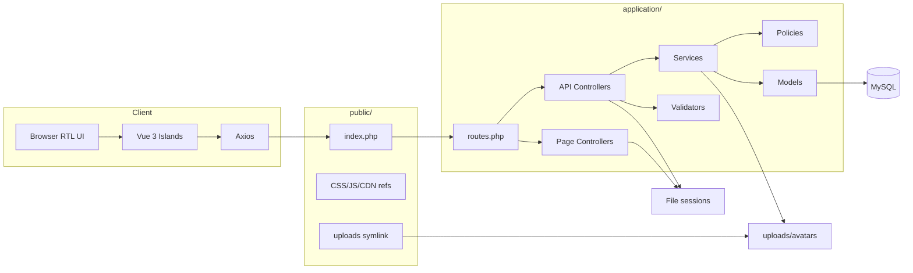
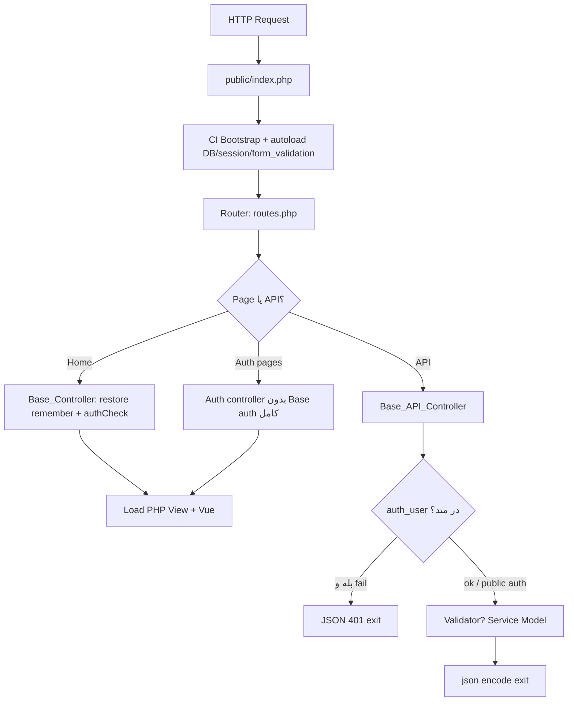
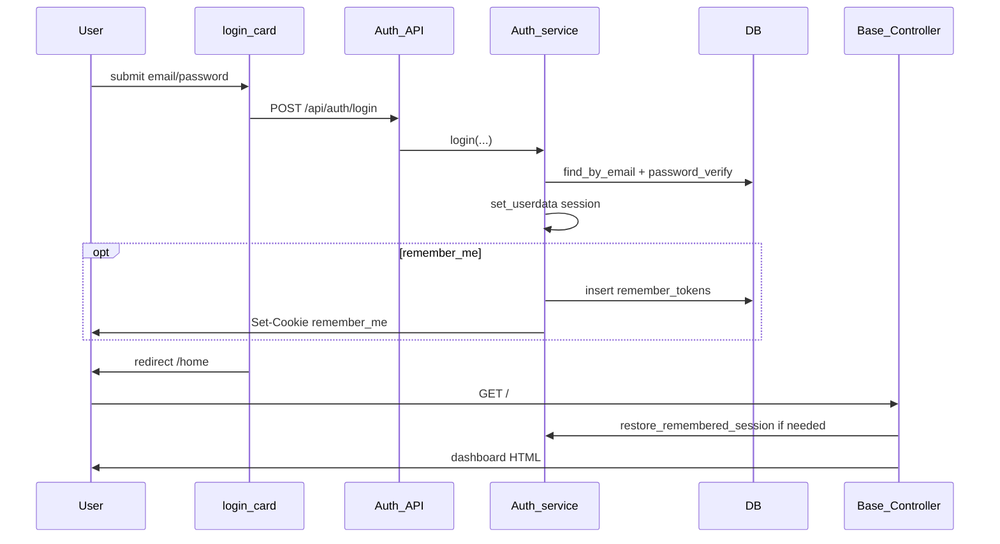
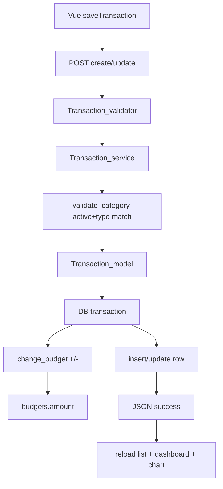
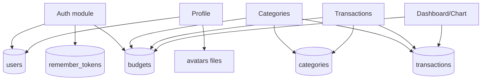
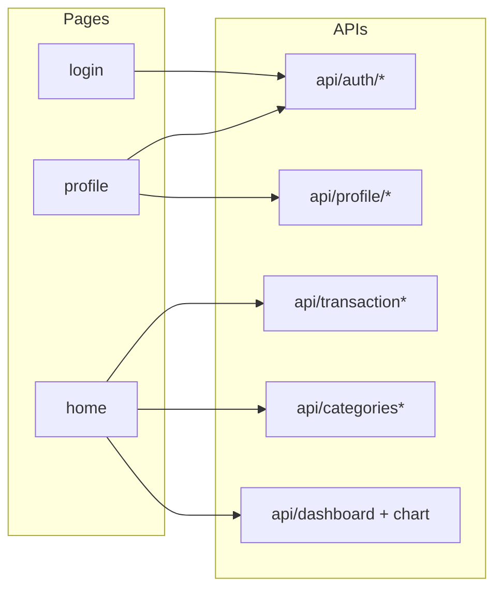

# ۱۱. نقشه‌های معماری

همه دیاگرام‌ها بر اساس پیاده‌سازی تأییدشده هستند.

---

## A. معماری سیستم

**وجود ندارد در سیستم:** Redis/cache اختصاصی، queue worker، payment gateway، mailer.

---

## B. چرخه درخواست HTTP

---

## C. چرخه احراز هویت

---

## D. جریان اصلی کسب‌وکار: تراکنش و بودجه

---

## E. ER دیتابیس

← رجوع به `06-database-and-data-lifecycle.md`

---

## F. وابستگی ماژول‌ها

---

## G. یکپارچگی فرانت/بک

